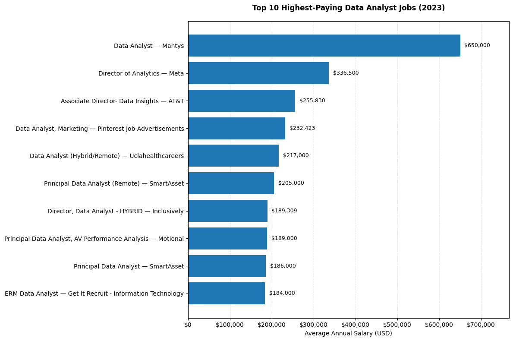
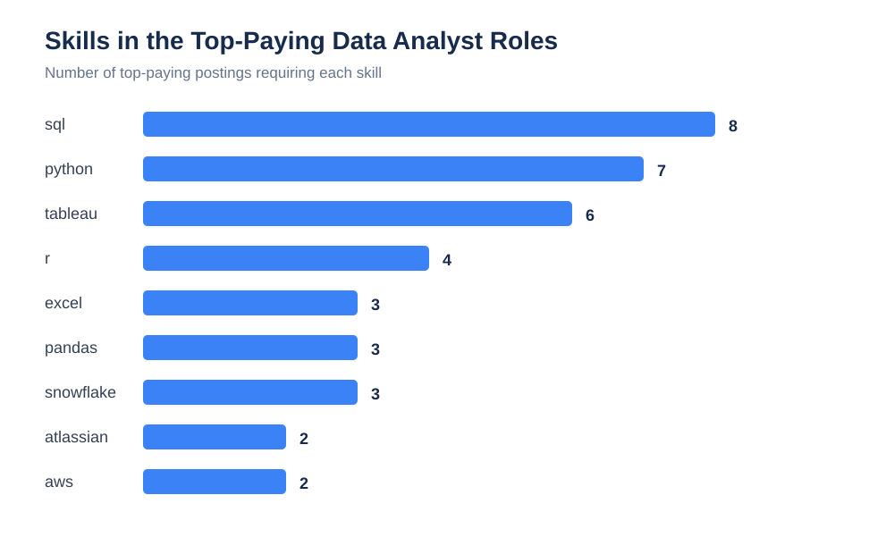
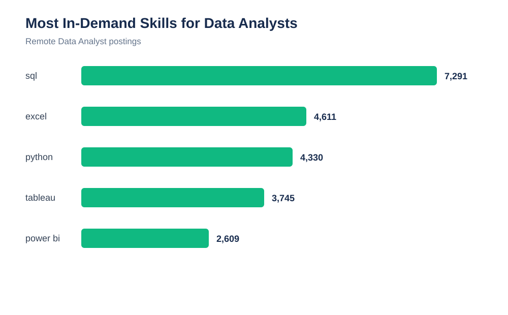
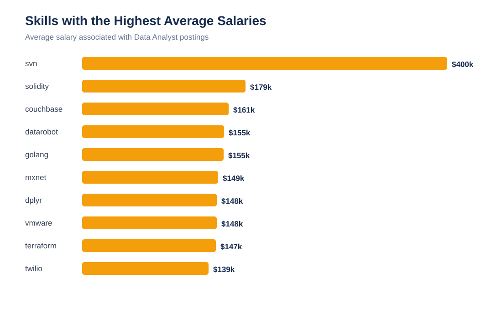
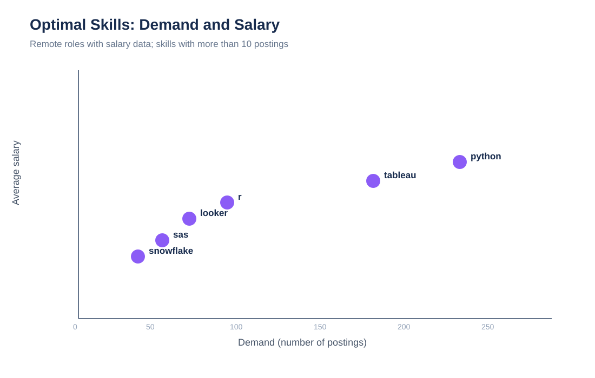

# Introduction
Dive into the data job market! Focusing on data analyst roles, this project explores top-paying jobs, in-demand skills, and where high demand meets high salary in data analytics.

SQL queries? Check them out here [project_sql folder](/project_sql/).

# Background
Driven by a quest to navigate the data analyst job market more effectively, this project was born from a desire to pinpoint top-paid and in-demand skills, streamining others work to find optimal jobs.

Data hails from [SQL Course](https://lukebarousse.com/sql). It's packed with insights on job titles, salaries, locations, and essential skills.
### The Questions I wanted to answer through my queries were:
- What are the top-paying jobs for my role?
- What are the skills required for these top-paying roles?
- What are the most in-demand skills for my role?
- What are the most optimal skills to learn?
  -  Optimal: High Demand AND High Paying

# Tools I Used
For my deep dive into the data analyst job market, I harnessed the power of several key tools:
- **SQL**: The backbone of my analysis, allowing me to query the database and unearth critical insights.
- **PostgreSQL**: The chosen database management system, ideal for handling the job posting data.
- **Visual Studio Code**: My go-to for database management and executing SQL queries
- **Git & Github**: Essential for version control and sharing my SQL scripts and analysis, ensuring collaboration and project tracking.

# The Analysis
Each query for this project aimed at investigating specific aspects of the data analyst job market.
Here's how I approached each question:

### 1. Top Paying Data Analyst Jobs
To Identify the highest-paying roles, I filtered data analyst positions by average yearly salary and location, focusing on remotes jobs. This query highlights the high paying opportunities in the field.

```sql
SELECT
    job_id,
    job_title,
    job_title_short,
    job_location,
    job_schedule_type,
    salary_year_avg,
    job_posted_date,
    company_dim.name AS company
FROM
    job_postings_fact
LEFT JOIN company_dim
    ON job_postings_fact.company_id = company_dim.company_id
WHERE
    job_title_short = 'Data Analyst' AND
    job_location = 'Anywhere' AND
    salary_year_avg IS NOT NULL
ORDER BY
    salary_year_avg DESC
LIMIT 10
```
Here's the breakdown of the top data analyst jobs in 2023:
- **Wide Salary Range:** Top 10 paying data analyst roles span from $184,000 to $650,000, indicating signifcant salary potential in the field.
- **Diverse Employers:** Companies like SmartAsset, Meta, and AT&T are among those offering high salaries, showing a broad interest across different industries.
- **Job Title Variety:** There's a high diversity in job titles, from Data Analyst to Director of Analytics, reflecting varied roles and specializations withing data analytics.
  
  *Bar graph visualizing the salary for the top 10 salaries for data analyst; ChatGPT generated this graph from my SQL query results*

### 2. Skills Required for Top-Paying Data Analyst Roles
To understand what employers expect in the highest-paid roles, I joined the top 10 jobs from the first query with the skills tables. The results returned skill information for eight of the ten roles.

```sql
WITH top_paying_jobs AS(
    SELECT job_id, job_title, job_title_short,
           salary_year_avg, company_dim.name AS company_name
    FROM job_postings_fact
    LEFT JOIN company_dim
        ON job_postings_fact.company_id = company_dim.company_id
    WHERE job_title_short = 'Data Analyst'
      AND job_location = 'Anywhere'
      AND salary_year_avg IS NOT NULL
    ORDER BY salary_year_avg DESC
    LIMIT 10
)
SELECT top_paying_jobs.*, skills_dim.skills
FROM top_paying_jobs
INNER JOIN skills_job_dim
    ON top_paying_jobs.job_id = skills_job_dim.job_id
INNER JOIN skills_dim
    ON skills_job_dim.skill_id = skills_dim.skill_id
ORDER BY salary_year_avg DESC;
```

**ChatGPT analysis of the results:**

> SQL appeared in all eight postings with available skill data, followed by Python in seven postings and Tableau in six. R appeared in four postings, while Excel, Pandas, and Snowflake each appeared in three. Cloud and big-data tools such as AWS, Azure, Databricks, Hadoop, and PySpark also appeared in several senior roles.

These results suggest that SQL is the essential foundation, while Python and visualization skills help analysts qualify for more advanced and better-paid positions. Cloud platforms and data-processing libraries are useful additions for moving into principal, director, or analytics-engineering work.


*Chart showing how often each skill appeared in the top-paying roles with available skill data.*

### 3. Most In-Demand Skills for Data Analysts
For this question, I counted skills across remote Data Analyst job postings. SQL was the most frequently requested skill, appearing in 7,291 postings. Excel ranked second with 4,611 postings, followed by Python with 4,330, Tableau with 3,745, and Power BI with 2,609.

```sql
SELECT
    skills,
    COUNT(*) AS skills_count
FROM job_postings_fact
INNER JOIN skills_job_dim
    ON skills_job_dim.job_id = job_postings_fact.job_id
INNER JOIN skills_dim
    ON skills_dim.skill_id = skills_job_dim.skill_id
WHERE job_title_short = 'Data Analyst'
  AND job_work_from_home = TRUE
GROUP BY skills
ORDER BY skills_count DESC
LIMIT 5;
```

**ChatGPT analysis of the results:**

> SQL is the clear market leader, so it should be the first priority for a Data Analyst. Excel remains highly relevant, showing that employers still value practical spreadsheet analysis. Python, Tableau, and Power BI round out the top five and demonstrate that employers want analysts who can manipulate data and communicate insights visually.

The demand results also show that SQL and Excel are useful across a broad range of analyst jobs, while Python and dashboarding tools can help differentiate candidates as they progress.


*Bar chart showing demand across remote Data Analyst postings.*

### 4. Skills Associated with the Highest Salaries
I also compared the average salary associated with each skill across Data Analyst roles with a reported salary. This is a separate view from demand: a skill can have a high average salary because it is concentrated in senior or specialized roles, even if it is not widely requested.

```sql
SELECT
    skills,
    ROUND(AVG(salary_year_avg), 0) AS avg_salary
FROM job_postings_fact
INNER JOIN skills_job_dim
    ON job_postings_fact.job_id = skills_job_dim.job_id
INNER JOIN skills_dim
    ON skills_job_dim.skill_id = skills_dim.skill_id
WHERE job_title_short = 'Data Analyst'
  AND salary_year_avg IS NOT NULL
GROUP BY skills
ORDER BY avg_salary DESC
LIMIT 25;
```

**ChatGPT analysis of the results:**

> The highest salary averages were generally connected to specialized programming, cloud, database, and enterprise-platform skills. This should not be interpreted as proof that a single skill causes a higher salary; seniority, company, industry, and job scope also influence the result.

This comparison is most useful when combined with demand. It helps distinguish skills that are associated with senior compensation from skills that are broadly required in everyday Data Analyst roles.


*Bar chart showing the ten skills with the highest average salaries in the query results.*

### 5. Most Optimal Skills to Learn
Finally, I looked for skills that combine market demand with strong salary potential. I focused on remote Data Analyst positions with a reported annual salary and required a skill to appear in more than ten postings. The results were ordered by average salary and then by demand.

```sql
SELECT
    skills_dim.skills,
    COUNT(DISTINCT skills_job_dim.job_id) AS demand_count,
    ROUND(AVG(job_postings_fact.salary_year_avg), 0) AS avg_salary
FROM job_postings_fact
INNER JOIN skills_job_dim
    ON job_postings_fact.job_id = skills_job_dim.job_id
INNER JOIN skills_dim
    ON skills_job_dim.skill_id = skills_dim.skill_id
WHERE job_title_short = 'Data Analyst'
  AND salary_year_avg IS NOT NULL
  AND job_work_from_home = TRUE
GROUP BY skills_dim.skill_id
HAVING COUNT(DISTINCT skills_job_dim.job_id) > 10
ORDER BY avg_salary DESC, demand_count DESC
LIMIT 25;
```

**ChatGPT analysis of the results:**

> Go, Confluence, Hadoop, Snowflake, and Azure had the highest average salaries among the skills that met the demand threshold. Python stood out as the strongest overall balance of demand and pay, with 236 postings and an average salary of about $101,397. R appeared in 148 postings at about $100,499, while Tableau appeared in 230 postings at about $99,288.

My recommended learning order is SQL first, followed by Excel and Python, then Tableau or Power BI. After building that foundation, cloud and warehouse technologies such as Snowflake, AWS, Azure, or BigQuery can provide a path toward higher-paying and more specialized roles. This approach balances the number of opportunities available with the potential salary associated with advanced skills.


*Scatter chart comparing demand and average salary for selected high-demand skills.*

# What I Learned

This project strengthened my ability to work with relational data and turn a broad career question into measurable SQL queries. In particular, I learned how to:

- Join fact and dimension tables to connect job postings, companies, and skills.
- Use filtering, grouping, aggregation, ordering, and `LIMIT` to answer targeted business questions.
- Use common table expressions to break a more complex analysis into smaller steps.
- Compare demand and salary instead of relying on only one metric.
- Treat query results as evidence rather than assuming that a high salary is caused by one skill.
- Use SQL results to create a clear, practical recommendation for skill development.

# Conclusions

The data shows that SQL is the most important skill for entering the Data Analyst market: it was the most in-demand skill in remote postings and appeared in nearly every top-paying role with available skill data. Excel also remains valuable, while Python, Tableau, and Power BI provide a strong combination of analysis, automation, and communication skills.

The best long-term strategy is to build a broad foundation first and specialize afterward. Python offers one of the strongest balances between demand and salary in this dataset. Cloud, warehouse, and big-data tools are less universal, but they are valuable additions for analysts targeting senior and highly paid roles.

These findings describe patterns in 2023 job postings, not guaranteed salary outcomes. Job title, seniority, location, industry, company, and the quality of a candidate's experience all affect compensation. Still, the analysis provides a practical roadmap: master SQL and Excel, add Python and visualization, then develop cloud or data-platform expertise.
